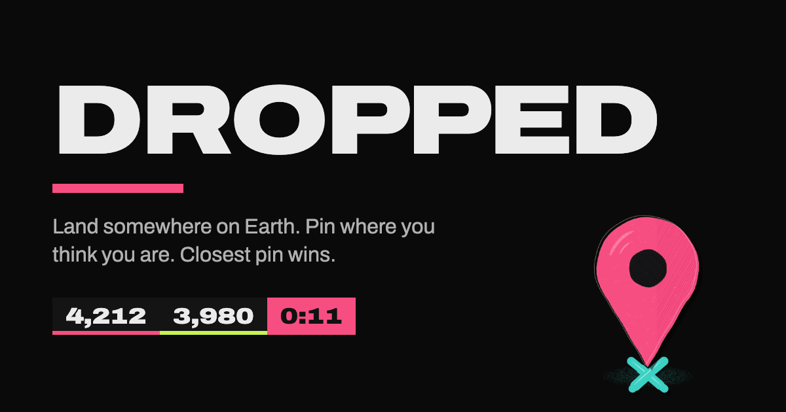
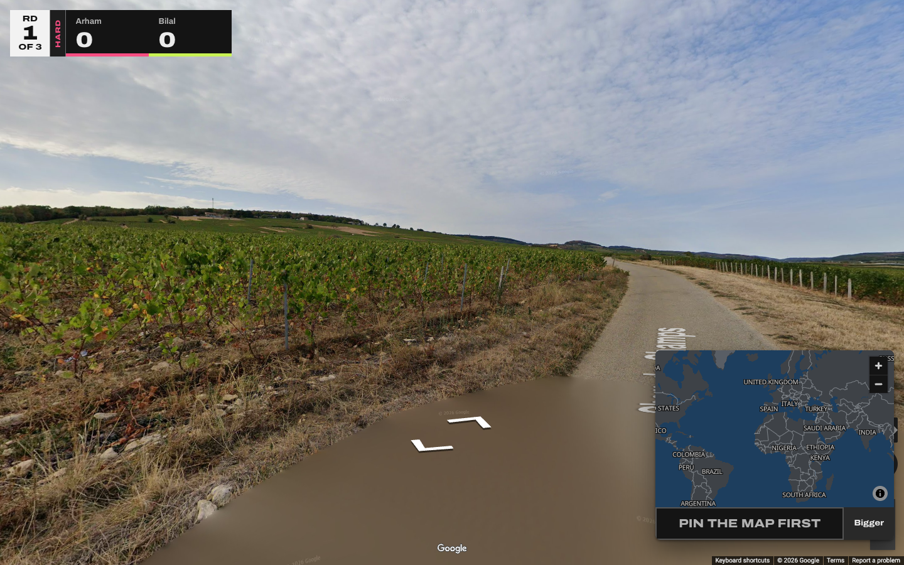
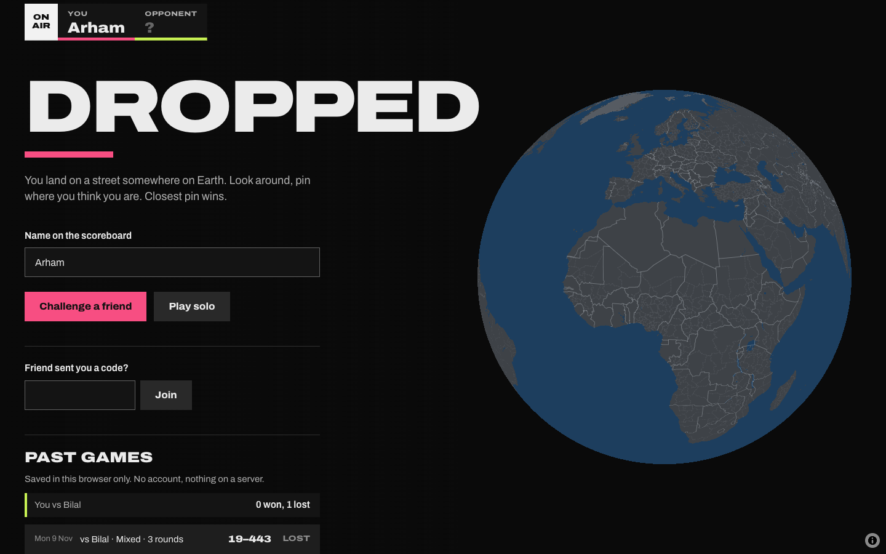
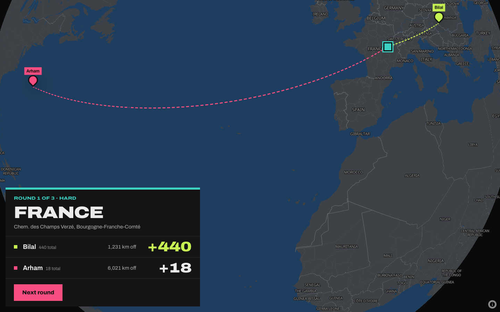
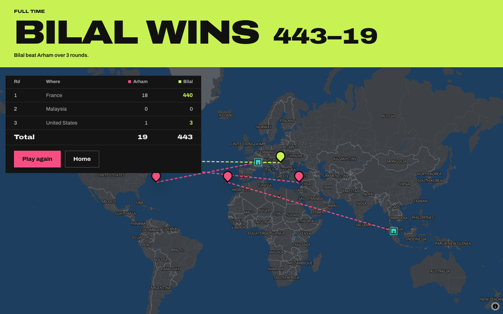
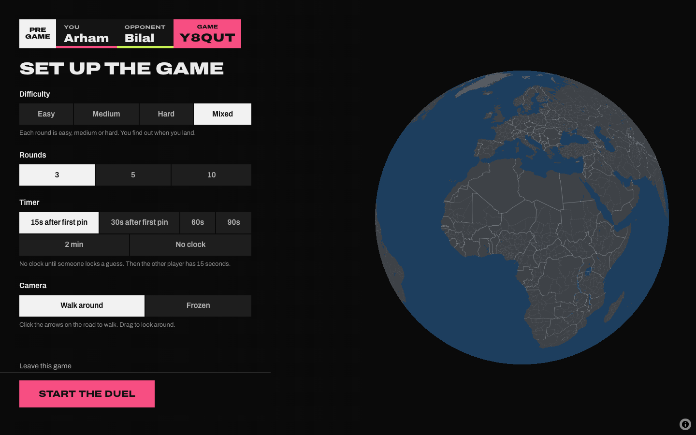
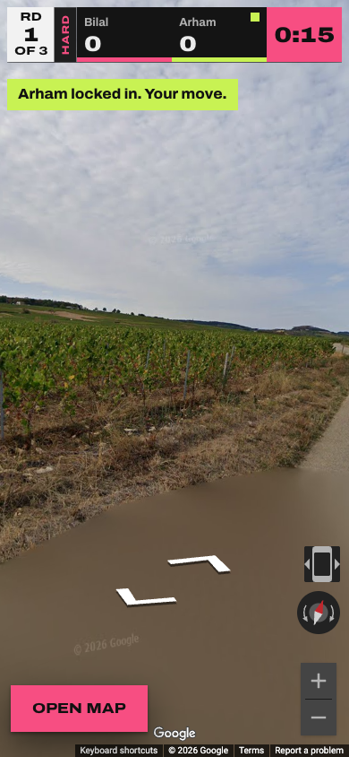

<p align="center">
  
</p>

<p align="center">
  <b>A street-view guessing game for you and one friend. Or just you.</b><br>
  You land on a random street somewhere on Earth, you pin where you think you are, closest pin wins.
</p>

<p align="center">
  <a href="https://dropped.arhamhfz.workers.dev"><b>Play it here</b></a> ·
  <a href="LICENSE">MIT licence</a> ·
  runs on one Cloudflare Worker
</p>

---

So I wanted a geo-guessing game I could play with one friend, live, both of us on the same round at
the same time.

So I built Dropped. You make a game, send your mate the link, pick the settings, and you both get
dropped on the same street. The scores and the clock update live on both screens.

<p align="center">
  
</p>

## How a game goes

1. Put your name in, hit **Challenge a friend**, send them the link (or the 5-letter code).
2. Pick the settings. Whoever made the game picks, the other person sees them change live.
3. You both land on the same street. Look around, walk down the road, then pin the map and lock it in.
4. The reveal flies the globe to the real spot, draws a line from each guess, and counts up the points.
5. After the last round you get the full-time screen, round by round, and a rematch button.

There's a **Play solo** button too if you just want to play on your own.

## Past games

No accounts. Every game you finish gets saved in your browser, and the home page shows them: your
record against each mate you've played, your best solo score, and every past game you can open up
round by round. It never touches a server, so it's per browser. Clear your browser data or switch
devices and it starts fresh. There's a button to wipe it yourself too.

<p align="center">
  
</p>

<p align="center">
  
</p>

## Settings

| Setting | Options |
|---|---|
| **Difficulty** | **Easy**: big cities, so street signs, shop fronts, landmarks. **Medium**: towns and the roads around them. **Hard**: back roads, a long way from any town. **Mixed**: every round is easy, medium or hard, you find out when you land. |
| **Rounds** | 3, 5 or 10 |
| **Timer** | **15s or 30s after the first pin**: no clock until one of you locks a guess, then the other person gets 15 or 30 seconds. **60s / 90s / 2 min** every round. **No clock** at all. |
| **Camera** | **Walk around**, or **Frozen**: one view, no walking and no turning. |

Scoring is 1,000 points a round for a perfect pin, and it drops off with distance. 100 km off is
about 936, 500 km is 717, 2,000 km is 264. If the clock runs out and you've dropped a pin but not
locked it, your pin still counts.

<p align="center">
  
</p>

## The Street View bit

This was the hard part, because Google's Street View API needs a key with billing turned on.

So by default Dropped uses Google's free Street View **embed**, the same thing you get when you
press "Embed a map" on Google Maps. No key, no bill. Two things to know about it though:

- It paints street names on the road sometimes. There's no setting to turn that off in the embed.
- The address box it shows in the corner is cropped off, so it doesn't give the answer away.

If you want it clean, give the Worker a **Google Maps JavaScript API key** and it switches to
Google's proper viewer with road labels and the address turned off, and Frozen mode becomes a real
no-moving mode. Lock the key to your domain in Google Cloud and set a daily quota on it, so it can
never run up a bill. Then:

```bash
npx wrangler secret put GOOGLE_MAPS_KEY
```

If the key ever fails, it falls back to the embed by itself.

Also, the coordinates never get sent to anyone's browser during a round. Your browser only gets
the panorama id, and the real location only comes through at the reveal. So you can't just open
dev tools and read the answer.

## The locations

There are 480 spots right now: 100 easy, 220 medium, 160 hard, from 72 countries. Every one
is an official Google car panorama. The indoor photo spheres people upload get thrown out.

They come from a script, not from me picking them. It takes a list of towns, picks a random point
the right distance away for the difficulty, snaps it to the nearest real road with
[OSRM](https://project-osrm.org/), then opens the Street View embed for that point in headless
Chrome and only keeps it if Google says it's their own car coverage. To grow the pools:

```bash
npm install
node tools/build-locations.mjs 150 300 220   # easy medium hard targets, it adds to what's there
```

The seed towns are in `tools/seeds.txt` (medium and hard) and `tools/easy-seeds.txt` (easy). Add
your own if you want more of a country.

One thing: since this repo is public, the answers are public too, in `src/data`. It's a game for
playing with your mates, so I'm fine with that.

## Run it yourself

You need Node 18+ and a Cloudflare account (the free plan is enough).

```bash
git clone https://github.com/arhamhi/dropped.git
cd dropped
npm install
npm run dev        # http://localhost:8787
npm run deploy     # puts it on your-name.workers.dev
```

There's no build step. It's plain HTML, CSS and JavaScript in `public/`, and the game server is
`src/room.js`.

<p align="center">
  
  
</p>

## How it's built

- **One Cloudflare Worker** serves the page and handles the WebSockets.
- **One Durable Object per game.** It holds the whole game: players, settings, the rounds, the clock.
  The browsers just draw whatever it sends. The clock is a Durable Object alarm, so it still fires
  if somebody closes their laptop.
- **Maps** are [MapLibre](https://maplibre.org/) with free vector tiles from
  [OpenFreeMap](https://openfreemap.org/), recoloured to match the game.
- **Type** is [Archivo](https://fonts.google.com/specimen/Archivo), using its width axis for the
  stretched TV-graphics look.

The icon is a pin cut from pink paper, stuck into a teal X, drawn in code with my hand-drawn
canvas kit (no image files go in, the picture is made stroke by stroke). The drawing is in `icons/`,
and `icons/build.sh` redraws it and writes every size into `public/`, then
`node tools/render-assets.mjs` rebuilds the share image.

The look came out of [Oxfords](https://github.com/arhamhi/oxfords), my UI/UX skill, along with
Impeccable and a web-designer skill: three directions were drawn up (a sports broadcast, an arcade
cabinet, a passport stamp), and the broadcast one won. The notes are in `docs/DIRECTION.md`.

`tools/e2e.mjs` plays a full game with two headless players, one on a laptop and one on a phone,
and screenshots every screen. Run it against your own deploy with
`node tools/e2e.mjs https://your-name.workers.dev`.

## Credits

Street View imagery © Google. Map data © [OpenStreetMap](https://www.openstreetmap.org/copyright)
contributors, tiles by [OpenFreeMap](https://openfreemap.org/), road snapping by
[OSRM](https://project-osrm.org/).

Dropped is a fan project. It's not affiliated with or endorsed by GeoGuessr or Google.

MIT licence, do what you want with it.
